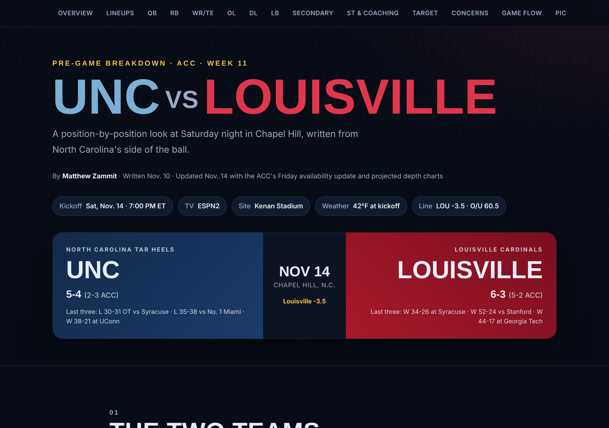

# unc-louisville-preview

Pre-game breakdown of North Carolina vs Louisville (Saturday, Nov. 14, 2026, 7:00 PM ET, Kenan Stadium, ESPN2), written from the Tar Heels' side. Covers both teams, every position group, where UNC should target, where it should be concerned, how the game breaks down, and a 34-31 UNC pick. Updated for the ACC Friday availability report, assuming all probable players play.

## View it

Open `index.html` in a browser. It is a single self-contained file (fonts load from Google Fonts), so nothing needs to be built or installed.

To host it on GitHub Pages, push this folder to a repository named `unc-louisville-preview`, then enable Pages from the main branch root in the repository settings.
